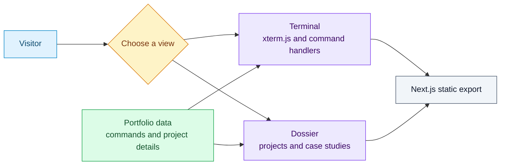

# CODERHINO Terminal Portfolio

An interactive, highly immersive "hacker-terminal" web portfolio built with Next.js, TypeScript, and xterm.js. Experience a fully functional terminal interface in your browser complete with ASCII art, typewriter effects, CRT scanlines, and an authentic boot sequence.

Live portfolio: [portfolio.wpperez.com](https://portfolio.wpperez.com)

## Two ways to explore the portfolio

The same static Next.js application offers an interactive terminal and a scrollable dossier. Content, commands, and presentation stay in separate modules.



For content edits, start with [terminal configuration](TERMINAL_CONFIGURATION.md). For layout changes, inspect `src/components/PortfolioDossier.tsx` and `src/styles/globals.css`.

## 🚀 Features

- **Immersive Boot Sequence**: Authentic Linux-style kernel loading animation.
- **Interactive Terminal**: Real terminal experience powered by `xterm.js` and custom parsing logic.
- **Visual Effects**: Matrix-style binary rain, CRT monitor scanlines, and glitch transitions.
- **Auditory Experience**: Mechanical keyboard typing sounds and audio cues (toggleable).
- **Themes & ASCII Art**: Custom rhino branding, dynamic theme switching (Green, Amber, Monochrome).
- **System Tools**: Built-in mock commands like `top`, `htop`, `neofetch`, and `matrix` mode.
- **Hidden CTF Challenges**: Find hidden flags and secret files spread across the application.
- **Project capture panel**: A sideways scrolling strip of real interface captures and labeled execution evidence. Hover/focus pauses it; the viewer supports larger images, keyboard navigation, and source links. Reduced-motion preferences disable automatic scrolling.
- **Responsive Design**: Adapts cleanly from ultra-wide monitors down to mobile devices.
- **Extensible Architecture**: Easy to add new commands via JSON configuration.

## 🛠️ Tech Stack

- **Next.js 15** - React framework with static export
- **TypeScript** - Type-safe development
- **xterm.js** - Terminal emulator for the browser
- **CSS Modules & Custom CSS** - No heavy component libraries, just pure styling

## 📦 Installation

1. **Clone the repository**
   ```bash
   git clone https://github.com/C0deRhin0/Web-Portfolio.git
   cd Web-Portfolio
   ```

2. **Install dependencies**
   ```bash
   npm install
   ```

## 🏃‍♂️ Development

### Run in Development Mode
```bash
npm run dev
```
Open [http://localhost:3000](http://localhost:3000) to view the portfolio.

### Build for Production
```bash
npm run build
```
This creates a static export in the `out/` directory.

### Preview Production Build
```bash
npx serve out/
```

## 📝 Adding New Commands

The portfolio is designed to be easily extensible. To add new commands, edit `src/data/commands.json`.

```json
{
  "cmd": "skills",
  "desc": "My technical skills",
  "category": "Portfolio",
  "outputLines": [
    "Languages: JavaScript, TypeScript, Python, Go",
    "Security: Penetration Testing, CTF"
  ]
}
```

The terminal's `help` command automatically picks up new entries defined in the JSON file.

### Built-in Commands

- `help` - Shows all available commands dynamically
- `clear` - Clears the terminal and shows the welcome banner
- `whoami` / `projects` / `skills` / `experiences` - Portfolio content
- `resume` / `contact` / `education` / `certifications` - Recruiter-facing quick info
- `cd` / `ls` / `run` - Simulated filesystem commands
- `theme [1/2/3]` - Change terminal color theme
- `effects [crt|glitch|sounds] [on/off]` - Toggle visual/audio enhancements
- `matrix` / `neofetch` / `top` - System tool simulations

## 🎨 Customization

- **Visual Effects**: Edit `src/components/effects/` and `src/components/BinaryRainOverlay.tsx`
- **Boot Sequence**: Tweak boot messages and kernel logs in `src/utils/bootMessages.ts`
- **Global Styling**: Update `--terminal-bg` and other variables in `src/styles/globals.css`

## 📁 Project Structure

```
src/
├── components/
│   ├── terminal/         # Core terminal components & handlers
│   ├── effects/          # CRT, Glitch, Audio components
│   └── BootSequence.tsx  # Initial loading screen
├── data/
│   └── commands.json     # Dynamic command definitions
├── styles/
│   └── globals.css       # Global styles & variables
├── utils/
│   └── commandParsing.ts # Tokenizer and command logic
└── pages/
    └── index.tsx         # Main entry point
```

## 👨‍💻 Author

**Wilfredo Paulo A. Perez III ("C0deRhin0")**
- Cybersecurity Engineer · AI Systems Builder · Cloud Security Practitioner
- Naga City, Camarines Sur, Philippines

---

*Built with ❤️ and lots of terminal love. Can you find all the flags?*

## Project screenshots

The dossier landing page and Projects folder show a Windows-style **Project screenshots** window with beveled frames, a blue title bar, and a scrolling filmstrip. Each case study uses the same window, filtered to that project's images. Capture descriptions live in `src/data/projectScreenshots.ts`; optimized images live in `public/projects/`. Running interfaces, fictional sample data, CLI output, architecture illustrations, and documentation captures carry distinct labels. Private repository captures stay out of the public panel.

Update the typed manifest when adding a capture. Describe what was actually exercised and any integration left untested; individual images can override the project's evidence label and note. Preserve original PNGs in your local capture archive; repository copies use WebP to reduce page weight. Hover or keyboard focus pauses the strip, and touch pauses it before selection. Reduced-motion preferences disable automatic scrolling. The enlarged viewer supports Escape, left/right arrows, and a source link.

Use solid color surfaces and beveled borders throughout the interface; do not add gradients. Gallery cards reserve equal rows for the image, two-line caption, and evidence label, with padding and borders included in their dimensions. Collections scroll only when their contents exceed the available width. Every visible card, including a repeated copy in a scrolling strip, opens its screenshot. Repeated copies stay outside the keyboard sequence and return focus to the accessible strip after closing the viewer.

Terminal mode uses a bounded canvas of staggered binary trails with fading tails and brighter tips, fitted to the content margins. Animation stops when the tab is hidden or reduced motion is enabled, and the overlay is disabled in dossier mode and on small screens.
